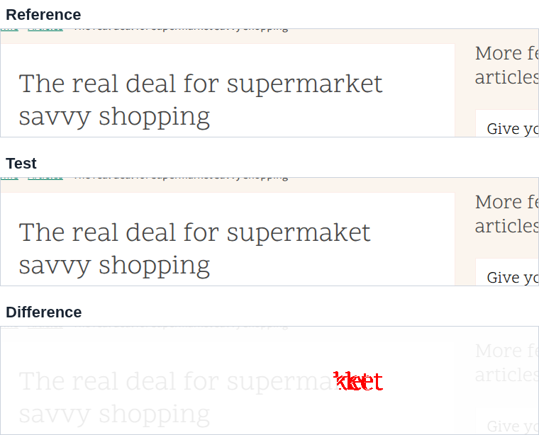

# Eaglediff

**Eaglediff** is a visual regression testing tool for websites. It captures
pages in a real browser, compares them with saved reference screenshots, and
shows what changed in an HTML report. It aims to be a BackstopJS alternative
that works on real sites with little configuration: it waits for lazy images,
web fonts and page scripts, and steadies carousels, animations, videos and
cookie banners before each screenshot. Comparison uses
[reg-suit](https://github.com/reg-viz/reg-suit).



*A one-letter typo ("supermaket") in a heading, found on a phone-sized
screenshot of a long page.*

## Install

Eaglediff needs Node.js 22.12 or newer and Chrome or Chromium.

```bash
npm install -g eaglediff
```

See [Installation](docs/installation.md) for prerequisites, installing from
source, and macOS and Windows (untested).

## Quick start

From your project's root folder, create a test folder and compare the site with
itself first:

```bash
mkdir -p tests/eaglediff
cd tests/eaglediff

# Find up to 25 pages and create config.json
eaglediff config --ref=https://example.com

# Save the reference screenshots
eaglediff reference

# Capture the same site again and compare: this should pass
eaglediff calibrate

# Open the report
eaglediff report
```

If calibration fails, the site changes between visits (rotating content, ads,
animations). See [Hooks and site adjustments](docs/site-adjustments.md) for
settings that steady it, and recalibrate.

Then set `testBaseURL` in `config.json` to your staging or local site and
compare it with the references:

```bash
eaglediff test
eaglediff report

# After reviewing the report, accept the changes as the new references
eaglediff approve
```

`test` exits with `0` when every page passes and `1` when something changed,
so it works in CI.

## How well does it find bugs?

The [benchmarks](docs/benchmarks.md) add known visual bugs to demo sites and
count how many are found, and how many unchanged pages are wrongly flagged.
Anyone can set them up and run them with any tool.

| Site | Bugs found | False alarms |
| --- | --- | --- |
| Drupal 11 Umami demo | 18 of 19 | 0 |
| WordPress with Elementor (carousels, counters, animations) | 12 of 13 | 0 |

Both used Eaglediff's default settings, with no site-specific configuration.

## Documentation

- [Installation](docs/installation.md): prerequisites, source installs, supported systems
- [Commands and configuration](docs/configuration.md): commands, settings, comparison thresholds, team defaults
- [Hooks and site adjustments](docs/site-adjustments.md): what Eaglediff does to each page and how to steady difficult sites
- [Troubleshooting](docs/troubleshooting.md): capture errors, retries and logs
- [Coming from BackstopJS](docs/backstop.md): differences and importing a `backstop.json`
- [Benchmarks](docs/benchmarks.md): results and how to reproduce them
- [Contributing](docs/contributing.md) and [Architecture](docs/architecture.md)

## License

[MIT](LICENSE)
